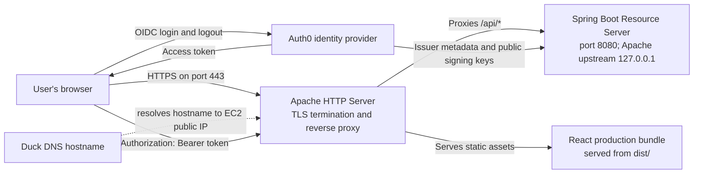

# Enterprise Risk Lab: A Secure Web System as an Enterprise Risk Control

## 1. Project overview

**Enterprise Risk Lab** is an educational implementation of a small web system that demonstrates how identity management, token-based API protection, transport encryption, and reverse-proxy deployment can operate together as enterprise risk controls. The system consists of a React single-page application (SPA), an Auth0 identity provider, and a Spring Boot OAuth 2.0 Resource Server. In the deployment model, Apache serves the production frontend, terminates HTTPS, and forwards API requests to the backend running on an Ubuntu Amazon EC2 instance.

The frontend and backend are maintained in separate repositories:

- **Backend and system documentation:** [EnterpriseRiskLab](https://github.com/ccastano46/EnterpriseRiskLab)
- **Dedicated React frontend:** [EnterpriseRiskLabFront](https://github.com/ccastano46/EnterpriseRiskLabFront)

Although the source code is divided between two repositories, this README describes the architecture and deployment of the complete system. It follows the implementation documented in the backend repository as its primary reference; the workshop specification is used as context rather than as a substitute for the project’s actual configuration.

### Learning outcomes

The laboratory demonstrates how to:

1. Distinguish user authentication from API authorization.
2. Obtain an Auth0 access token in a browser application and transmit it as a bearer token.
3. Configure a Spring Boot resource server to validate JWT-based requests.
4. Restrict cross-origin requests to explicitly configured browser origins.
5. Deploy a Java service and static frontend on Linux, with Apache acting as a TLS endpoint and reverse proxy.
6. Use DNS and a Let’s Encrypt certificate to provide a public HTTPS address.
7. Identify controls that mitigate risks related to identity, access, and data in transit.

## 2. System architecture



| Component | Responsibility in this project |
|---|---|
| **Auth0** | Authenticates users and issues access tokens for the configured API audience. The workshop configuration defines the `read:risk` permission and grants the SPA user-delegated access to the API. |
| **React SPA** | Presents the user interface, initiates login/logout through Auth0, requests an access token, and calls the protected API with an `Authorization: Bearer <token>` header. Its source is maintained in the separate frontend repository. |
| **Spring Boot API** | Acts as an OAuth 2.0 Resource Server. `RiskController` exposes `GET /api/risk-status`; `SecurityConfig` configures JWT authentication, request rules, and CORS. |
| **Apache HTTP Server** | Serves the compiled frontend, terminates public HTTPS connections, and reverse-proxies `/api/` requests to the backend on the same EC2 instance. |
| **Amazon EC2 (Ubuntu)** | Hosts Apache, the backend process, and the compiled frontend assets. The application’s Java port is not intended to be exposed directly to the public internet. |
| **Duck DNS** | Resolves the chosen hostname to the EC2 public IP address. The DNS record must point to the current public address before certificate issuance. |
| **Certbot and Let’s Encrypt** | Obtain and renew the TLS certificate used by Apache for the public HTTPS endpoint. |

### Frontend repository and architecture

The React application is **not** stored in this backend repository. It has its own source repository, [EnterpriseRiskLabFront](https://github.com/ccastano46/EnterpriseRiskLabFront), which should be cloned and built independently. In the repository’s current layout, the Vite project is under the `frontend/` directory.

The frontend’s principal responsibilities are divided as follows:

- `src/main.jsx` mounts the React application and wraps it in `Auth0Provider`. The provider receives its domain, client identifier, callback URI, and API audience from Vite environment variables.
- `src/App.jsx` coordinates the login and logout actions, obtains an access token with `getAccessTokenSilently()`, and sends a `GET` request to `/api/risk-status` with the bearer token. It represents loading, success, and error states in the interface.
- `src/App.css` and `src/index.css` provide component-level and global presentation styles.
- `package.json` defines the Vite development, build, lint, and preview scripts.

The browser uses the Auth0 React SDK to obtain a token; it does not contain an Auth0 client secret. Vite variables prefixed with `VITE_` are included in client-side code and must therefore be treated as public configuration, not as a secret store.

## 3. Backend security model and API

The backend is a Spring Boot 4 application built for Java 21. Its configuration reads the Auth0 issuer, API audience, and allowed CORS origins from environment variables:

| Variable | Purpose | Example format |
|---|---|---|
| `AUTH0_DOMAIN` | JWT issuer URI expected by the resource server. Use the tenant URL with the `https://` scheme and trailing slash. | `https://YOUR_TENANT.us.auth0.com/` |
| `AUTH0_AUDIENCE` | Audience identifier of the protected API. It must match the Auth0 API identifier and the SPA audience. | `https://enterprise-risk-api` |
| `CORS_ALLOWED_ORIGINS` | Comma-separated list of exact browser origins permitted by the backend. | `http://localhost:5173,https://YOUR_SUBDOMAIN.duckdns.org` |

The current `SecurityConfig` marks `/actuator/health` as permitted, requires authentication for `/api/**`, and denies other requests. Separately, CORS permits the configured origins, the `GET` method, and the `Authorization` and `Content-Type` headers. The controller provides:

```http
GET /api/risk-status
Authorization: Bearer <access-token>
```

A successful response has the following structure; `subject` is supplied by the authenticated JWT:

```json
{
  "status": "protected",
  "subject": "<authenticated-subject>",
  "control": "JWT validation and authenticated access"
}
```

### Authentication and authorization distinction

Authentication establishes that the token represents a valid authenticated principal. Authorization determines whether that principal may perform a particular operation. The Auth0 laboratory configuration defines the API permission `read:risk` and grants the SPA user-delegated access. **At the current backend revision, however, `SecurityConfig` requires authentication for `/api/**` but does not explicitly check the `read:risk` scope or authority.** Consequently, the README describes the implemented behavior as authenticated access; it does not claim that the backend enforces scope-level authorization.

The backend disables CSRF protection and uses bearer-token authentication. This configuration assumes that the API remains stateless and does not use browser session cookies for authentication. Reassess the CSRF configuration if the authentication model changes.

> **Health endpoint note:** The security configuration permits `/actuator/health`, but the current `pom.xml` does not include `spring-boot-starter-actuator`. Therefore, the security rule alone does not create that endpoint. Unless Actuator is added in a later code change, use `systemctl` and the protected API’s expected unauthenticated `401` response to verify the service instead.

## 4. Prerequisites

### Development machine

- Java Development Kit (JDK) 21.
- Apache Maven installed and available as `mvn`.
- Node.js and npm.
- Git.
- An Auth0 tenant with an API and a Single Page Application (SPA) configured for this laboratory.

### Deployment server

- An Ubuntu Linux EC2 instance that you administer.
- Java 21 runtime, Apache HTTP Server, Certbot, and the Certbot Apache plugin.
- A Duck DNS hostname configured to resolve to the instance’s public IP address.
- A security group that allows inbound TCP traffic on ports `80` and `443`. Allow SSH on port `22` only from trusted administrative IP addresses. **Do not expose backend port `8080` to the public internet.**

## 5. Configure Auth0

Create the API before configuring the SPA so that the application can be granted access to the correct resource server.

1. In Auth0, create an API named **Enterprise Risk Lab API**.
2. Set its identifier (audience) to `https://enterprise-risk-api` and use the **RS256** signing algorithm.
3. Define the `read:risk` permission for the API.
4. Create a **Single Page Application** named **Enterprise Risk Lab Frontend**.
5. Configure the SPA’s callback, logout, and web-origin allowlists. Replace the example hostname with the deployment hostname:

   ```text
   Local development:  http://localhost:5173
   Deployed frontend:  https://YOUR_SUBDOMAIN.duckdns.org
   ```

6. Under the SPA’s API access settings, grant **User-Delegated Access** to the Enterprise Risk Lab API and select `read:risk` (or the permissions required by the course configuration).
7. Create an Auth0 test user for the browser login flow.

These allowlists should contain the exact local and deployed origins. Do not use broad wildcard entries. A browser application must not contain an Auth0 client secret.


## 6. Run the backend and frontend locally

### 6.1 Start the Spring Boot backend

From the root of the `EnterpriseRiskLab` repository, export the values read by `application.properties` and start Spring Boot:

```bash
export AUTH0_DOMAIN="https://YOUR_TENANT.us.auth0.com/"
export AUTH0_AUDIENCE="https://enterprise-risk-api"
export CORS_ALLOWED_ORIGINS="http://localhost:5173"
mvn spring-boot:run
```

`mvn spring-boot:run` compiles and starts the application during development. The backend listens on port `8080`, as specified by `server.port=8080`. The CORS variable is required by `SecurityConfig`; omitting it can prevent the application from creating its CORS configuration.


### 6.2 Configure and start the separate React application

Clone the dedicated frontend repository and move into its Vite project directory:

```bash
git clone https://github.com/ccastano46/EnterpriseRiskLabFront.git
cd EnterpriseRiskLabFront/frontend
npm ci
```

`npm ci` installs the exact dependency versions recorded in `package-lock.json`, making local and CI installations more reproducible. Create an ignored `.env.local` file in this directory with the SPA’s public configuration:

```dotenv
VITE_AUTH0_DOMAIN=YOUR_TENANT.us.auth0.com
VITE_AUTH0_CLIENT_ID=YOUR_SPA_CLIENT_ID
VITE_AUTH0_AUDIENCE=https://enterprise-risk-api
VITE_API_URL=http://localhost:8080
```

`VITE_AUTH0_DOMAIN` is the tenant hostname used by the browser SDK; unlike the backend issuer URI, it is provided without the `https://` prefix. `VITE_API_URL` is the API base origin. The frontend appends `/api/risk-status`, so do not add `/api` to this value.

Start the Vite development server:

```bash
npm run dev
```

Vite normally serves the local SPA at `http://localhost:5173`. That exact origin must be present in the Auth0 callback, logout, and web-origin allowlists and in the backend’s local `CORS_ALLOWED_ORIGINS` value.

The frontend repository’s `.gitignore` excludes `.env.local` and other `*.local` files. Do not commit private credentials. The SPA requires a public client ID, not a client secret.


## 7. Prepare the EC2 server and Duck DNS

### 7.1 Configure access to the instance

Launch or select an Ubuntu EC2 instance and restrict its inbound rules to the system’s public entry points:

| Port | Purpose | Recommended source |
|---|---|---|
| `22` | Administrative SSH access | Your trusted public IP address or administrative network only |
| `80` | HTTP access and the HTTP-01 certificate challenge | Public internet, if required for the public website and Certbot validation |
| `443` | Public HTTPS access | Public internet |
| `8080` | Internal Spring Boot application port | Do not open in the EC2 security group |

The Apache reverse proxy connects to the backend locally on the instance. Exposing port `8080` would bypass the intended public HTTPS entry point and is unnecessary for normal use.

When connecting from a trusted local machine, restrict access to the SSH private key and use the Ubuntu account associated with the EC2 image:

```bash
chmod 400 /path/to/key.pem
ssh -i /path/to/key.pem ubuntu@EC2_PUBLIC_IP
```

`chmod 400` limits access to the private key file for its owner, as required by common SSH clients. Replace the key path and address with the values for the selected instance; never upload the private key to either repository.


### 7.2 Install the runtime and web-server packages

Connect to the instance over SSH, refresh the package index, and install the Java runtime, Apache, and Certbot components:

```bash
sudo apt update
sudo apt install -y apache2 certbot python3-certbot-apache openjdk-21-jre
```

`apt update` refreshes the package catalogue before installation. `apache2` will serve the SPA and proxy API traffic; `openjdk-21-jre` runs the packaged Spring Boot application; `certbot` and `python3-certbot-apache` obtain and integrate the TLS certificate. The JDK and Maven are required on the build machine, not on this runtime server.

Check the installed runtime and web server:

```bash
java -version
sudo systemctl status --no-pager apache2
```

### 7.3 Configure Duck DNS

Create a Duck DNS subdomain and configure its DNS record to resolve to the EC2 instance’s current public IP address. If the address changes, update the DNS record before relying on the hostname or renewing the certificate.


Check if the server can resolve the subdomain


## 8. Build and package the applications

Build the two repositories independently. Run each command from the directory that contains its corresponding project file.

### Backend: executable JAR

From the root of `EnterpriseRiskLab`, run:

```bash
mvn clean package
```

Maven’s `clean` phase removes output from earlier builds, avoiding stale classes or artifacts. The `package` phase compiles the backend, runs any configured tests, and packages the application using the Spring Boot Maven plugin. The expected executable artifact is:

```text
target/EnterpriseRiskLab-1.0-SNAPSHOT.jar
```

### Frontend: production bundle

From the `frontend/` directory inside `EnterpriseRiskLabFront`, create `.env.production.local` with the production Auth0 values and the public HTTPS origin:

```dotenv
VITE_AUTH0_DOMAIN=YOUR_TENANT.us.auth0.com
VITE_AUTH0_CLIENT_ID=YOUR_SPA_CLIENT_ID
VITE_AUTH0_AUDIENCE=https://enterprise-risk-api
VITE_API_URL=https://YOUR_SUBDOMAIN.duckdns.org
```

Then run:

```bash
npm ci
npm run build
```

## Transfer the packaged artifacts to EC2

After building the backend JAR and frontend bundle as described in the preceding section, transfer only the generated artifacts; the server does not need the Git repositories or development dependencies to run the application.

From the backend repository root, copy the JAR to the Ubuntu user’s home directory:

```bash
scp -i /path/to/key.pem \
  target/EnterpriseRiskLab-1.0-SNAPSHOT.jar \
  ubuntu@EC2_PUBLIC_IP:~/app.jar
```

From the root of the cloned frontend repository, create a remote staging directory and copy the **contents** of its `frontend/dist/` directory:

```bash
scp -i /path/to/key.pem -r \
  frontend/dist/. \
  ubuntu@EC2_PUBLIC_IP:~/frontend-dist/
```

`scp` uses SSH to transfer the packaged application and static files. The staging paths make the next server-side installation steps explicit: the JAR will be installed under `/opt`, and the frontend files will be copied under Apache’s document root. Replace `EC2_PUBLIC_IP` and the key path with the actual values. Do not include access tokens, private keys, or client secrets in these files.


## 10. Deploy the backend as a systemd service

Running the API as a dedicated, non-login service account separates the application process from the SSH administrator account. The JAR is installed in `/opt/enterprise-risk-api`, and systemd supervises its startup and restart behavior.

### 10.1 Create the service account and install the JAR

Run the account-creation command once. If the account already exists, verify it with `id riskapi` rather than attempting to create it again:

```bash
sudo useradd --system --no-create-home --shell /usr/sbin/nologin riskapi
```

Create an application directory owned by the service account and copy the uploaded JAR into it:

```bash
sudo install -d -o riskapi -g riskapi -m 0750 /opt/enterprise-risk-api
sudo install -o riskapi -g riskapi -m 0640 \
  /home/ubuntu/app.jar \
  /opt/enterprise-risk-api/app.jar
```

`install -d` creates the deployment directory with restrictive directory permissions. The second `install` copies the JAR and sets its owner, group, and read permissions so the service can execute it without granting general write access.


### 10.2 Define the systemd unit

Create `/etc/systemd/system/enterprise-risk-api.service`:

```bash
sudo nano /etc/systemd/system/enterprise-risk-api.service
```

Use the following unit as a template. Replace the tenant and deployed hostname placeholders before saving it. The backend issuer URI must include `https://` and the trailing slash. `CORS_ALLOWED_ORIGINS` is required by the current application configuration; for this deployment, it should be the exact public frontend origin.

```ini
[Unit]
Description=Enterprise Risk Lab API
After=network.target

[Service]
Type=simple
User=riskapi
Group=riskapi
WorkingDirectory=/opt/enterprise-risk-api
Environment="AUTH0_DOMAIN=https://YOUR_TENANT.us.auth0.com/"
Environment="AUTH0_AUDIENCE=https://enterprise-risk-api"
Environment="CORS_ALLOWED_ORIGINS=https://YOUR_SUBDOMAIN.duckdns.org"
ExecStart=/usr/bin/java -jar /opt/enterprise-risk-api/app.jar
Restart=on-failure
RestartSec=5

[Install]
WantedBy=multi-user.target
```

`User` and `Group` run the process with the restricted account. `WorkingDirectory` establishes its runtime directory. The `Environment` entries supply the issuer, audience, and CORS origin read by Spring Boot. `ExecStart` starts the executable JAR, while `Restart=on-failure` asks systemd to restart it after an unexpected failure. These environment values are configuration, not Auth0 client secrets.


### 10.3 Load and start the service

After saving the unit, instruct systemd to reload unit definitions, enable the service at boot, and start it immediately:

```bash
sudo systemctl daemon-reload
sudo systemctl enable --now enterprise-risk-api
sudo systemctl status --no-pager enterprise-risk-api
```

`daemon-reload` makes systemd read the new unit file. `enable --now` both configures automatic startup and starts the service in the current session. `status` reports the service state and recent log lines. If startup fails, inspect the service journal:

```bash
sudo journalctl -u enterprise-risk-api -n 50 --no-pager
```

The following request intentionally omits a token. A `401 Unauthorized` response is expected when the server is reachable and the protected API is enforcing authentication:

```bash
curl -i http://127.0.0.1:8080/api/risk-status
```


## 11. Configure Apache and HTTPS

Apache is the public entry point. It serves the React build from its document root and forwards API calls to Spring Boot on loopback. The intended public interface is the Duck DNS HTTPS hostname; the Java port remains private to the EC2 instance.

### 11.1 Install the frontend build under Apache’s document root

On EC2, create the document root, copy the staged build, and assign the static files to Apache’s service account:

```bash
sudo install -d -o www-data -g www-data -m 0755 \
  /var/www/enterprise-risk-frontend
sudo cp -a /home/ubuntu/frontend-dist/. \
  /var/www/enterprise-risk-frontend/
sudo chown -R www-data:www-data /var/www/enterprise-risk-frontend
```

`cp -a` copies the contents of the staged bundle, including `index.html` and its generated assets. Keeping the files under `/var/www` allows Apache to serve the build without running the React development server in production.

### 11.2 Enable the Apache modules and configure the virtual host

Enable the modules required for TLS termination and reverse-proxying HTTP requests to the Spring Boot backend:

```bash
sudo a2enmod ssl proxy proxy_http
```

Create `/etc/apache2/sites-available/enterprise-risk.conf`:

```bash
sudo nano /etc/apache2/sites-available/enterprise-risk.conf
```

Use this HTTP virtual host as the initial configuration. Replace the hostname with the exact Duck DNS subdomain, and verify that both the document root and backend port match the instance:

```apache
<VirtualHost *:80>
    ServerName YOUR_SUBDOMAIN.duckdns.org
    DocumentRoot /var/www/enterprise-risk-frontend

    <Directory /var/www/enterprise-risk-frontend>
        Options -Indexes
        AllowOverride None
        Require all granted
        FallbackResource /index.html
    </Directory>

    ProxyPreserveHost On
    ProxyPass        /api/ http://127.0.0.1:8080/api/
    ProxyPassReverse /api/ http://127.0.0.1:8080/api/

</VirtualHost>
```

The `DocumentRoot` points to the static React bundle. `Options -Indexes` prevents directory listings, and `Require all granted` allows Apache to serve the public frontend files. `FallbackResource` returns `index.html` for frontend routes that are not physical files. The two `ProxyPass` directives route `/api/` requests to the backend without publishing port `8080`.

Enable the site, validate the Apache syntax, and reload the server:

```bash
sudo a2ensite enterprise-risk.conf
sudo apachectl configtest
sudo systemctl reload apache2
```

`a2ensite` enables the virtual host by creating the appropriate site configuration link. `apachectl configtest` must report `Syntax OK` before reloading. `systemctl reload` applies the validated configuration without unnecessarily stopping the web server.


### 11.3 Request and verify the TLS certificate

Before requesting a certificate, confirm that the Duck DNS hostname resolves to the instance and that inbound ports `80` and `443` are permitted. Then use Certbot’s Apache integration:

```bash
sudo certbot --apache --redirect -d YOUR_SUBDOMAIN.duckdns.org
```

Certbot validates control of the hostname, obtains a Let’s Encrypt certificate, and updates Apache’s virtual-host configuration. The `--redirect` option configures HTTP requests to redirect to HTTPS. Follow the interactive prompts and provide a valid contact email if requested.

After Certbot completes, validate and reload Apache, then inspect the certificate and simulate renewal:

```bash
sudo apachectl configtest
sudo systemctl reload apache2
sudo certbot certificates
sudo certbot renew --dry-run
```

`certbot certificates` lists the certificates managed on the server. `certbot renew --dry-run` tests the renewal process without replacing the active certificate. A successful renewal simulation is evidence that the automated renewal path can complete; it is not a substitute for testing the public HTTPS endpoint.


### Troubleshooting
## 13. Repository structure

### Backend repository

```text
EnterpriseRiskLab/
├── README.md
├── pom.xml
└── src/
    └── main/
        ├── java/eci/arem/
        │   ├── Main.java
        │   ├── config/SecurityConfig.java
        │   └── controller/RiskController.java
        └── resources/application.properties
```

### Dedicated frontend repository

```text
EnterpriseRiskLabFront/
└── frontend/
    ├── package.json
    ├── package-lock.json
    ├── index.html
    └── src/
        ├── main.jsx
        ├── App.jsx
        ├── App.css
        └── index.css
```


## 15. Implementation screenshots


